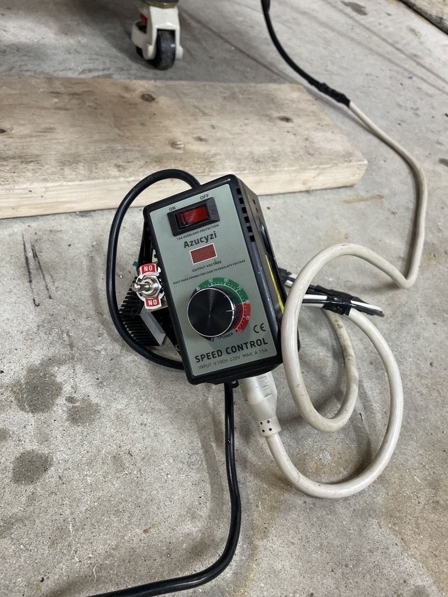
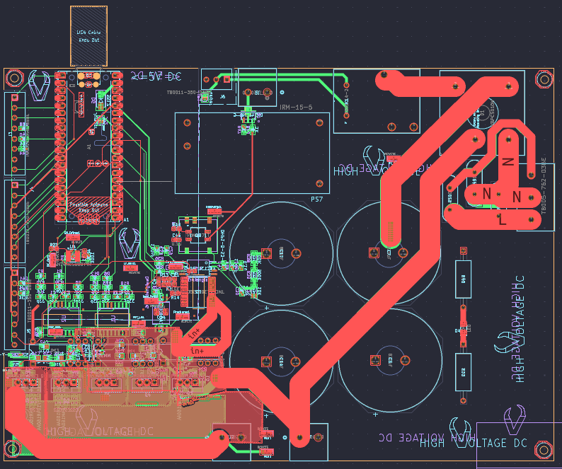

# High_Voltage_DC_Motor_Drive
The purpose behind this project is to make it easier to use things like a DC 1-3HP treadmill motor as a spindle for CNC machines. I've personally been using these as they run can be powered off 120V
with simply a [fan speed controller](https://a.co/d/0fW0k3Kj) followed by a bridge rectifier. My mill is currently set up this way and it's been funcitoning well for the last 3 years.

  

  <b>Figure 1.</b> The setup I've been using for years.

Obviously this is a bit sketchy and it has two large ish downsides:
1. The fan speed controller works by basically cutting the AC wave short, I believe this yields cruddy low speed torque.
2. You obviously cannot get linux CNC to work with the controller
3. There's no closed loop feedback to keep the motor at speed under load.

For these reasons and for the excuse to get better at embedded software and mechatronics, I figured I'd try to bring this motor controller to life.

  

  <b>Figure 1.</b> Motor Controller PCB Layout

I've wrapped up v1 of this board and kept it as it was under the Board_V1 branch. There have already been some mistakes which I'll be updating in this main branch.

# Active Todos!
- [ ] Get reliable rpm readout from the hall sensor
- [ ] Get a bench setup for a lower voltage motor
- [ ] Implement direction switching capabilities
